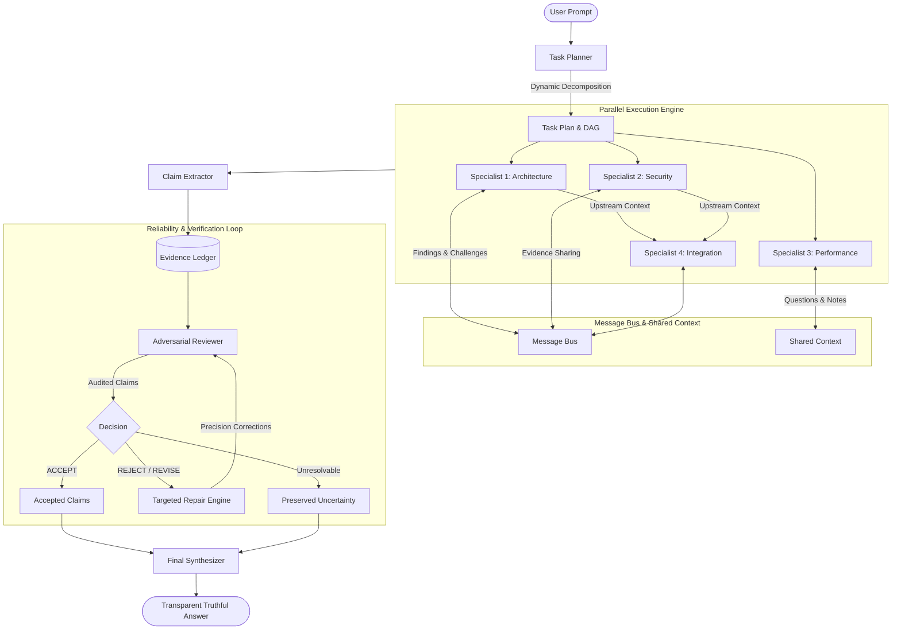

# MEDHA — Multi-Agent Evidence-Driven Architecture

[](https://www.python.org/)
[](https://groq.com/)
[](https://ai.google.dev/)
[]()
[](https://modelcontextprotocol.io/)

**SEED Hackathon 2026** | **Problem Statement 02 — Chain of Command**  
*Topic-Independent, Dynamically Orchestrated Multi-Agent Intelligence with Multi-Provider Architecture & Adversarial Evidence Auditing*

---

## 1. Executive Summary

Traditional LLM workflows and naive multi-agent systems suffer from common failure modes:
1. **Echo Chambers / False Consensus**: Agents with static personas simply agree with one another or uncritically validate the primary prompt.
2. **Ungrounded Confidence**: High token probabilities and self-assessed confidence scores masquerade as factual evidence.
3. **Rigid Predefined Roles**: Fixed agent configurations struggle when encountering novel, multi-disciplinary problems.
4. **All-or-Nothing Rejection**: When an answer contains a single flaw, the entire output is either rejected or accepted with the flaw intact.

**MEDHA** solves these fundamental issues through a dynamic, evidence-grounded multi-provider architecture:
- **Multi-Provider LLM Architecture**: Uses **Groq** (`openai/gpt-oss-20b`) as its high-speed primary LLM provider while retaining **Google Gemini** (`gemini-3.8-flash`) as a fully supported alternative.
- **Dynamic Specialist Creation**: Analyzes each user task to dynamically determine the exact domain expertise required and creates custom specialist agents on the fly.
- **Dependency-Aware Parallel Execution**: Automatically derives DAG dependencies, executing independent specialist subtasks concurrently while routing upstream findings to downstream specialists.
- **Structured Inter-Agent Message Bus**: Agents exchange formal findings, questions, evidence, and challenges across dedicated asynchronous inboxes.
- **Centralized Evidence Ledger**: Rigorously indexes every concrete assertion as an atomic claim tied to verified supporting evidence and source references.
- **Independent Adversarial Reviewer**: Audits claims using strict evidentiary criteria (challenging unverified leaps, superlatives, and hidden assumptions) rather than consensus.
- **Targeted Precision Repair**: Routes specific reviewer critiques back to the responsible specialist to narrow claims, declare explicit assumptions, or supply valid derivations.
- **Transparent Truthful Execution**: Reports truthful statuses (`SUCCESS`, `PARTIAL_FAILURE`, `FAILED`), explicitly discloses when zero claims were available for verification, and never presents unverified fallback text as truth.
- **Full Model Context Protocol (MCP) Server**: Exposes MEDHA tools over the official MCP Python SDK for seamless integration into external agent environments.
- **Quantitative Benchmarking Suite**: Evaluates MEDHA against a single-agent baseline on reference criteria coverage, claim support rates, repair efficiency, and token economics.

---

## 2. System Architecture



---

## 3. Project Structure

```
MEDHA/
│
├── main.py                     # Interactive CLI and application entry point
├── requirements.txt            # Project dependencies (groq, google-genai, pydantic, mcp)
├── .env                        # Local configuration and credentials (never committed)
├── .env.example                # Example multi-provider environment configuration
├── .gitignore                  # Git ignore rules
│
├── config/
│   ├── settings.py             # Multi-provider environment configuration & validation
│   └── logging_config.py       # Credential-redacting structured logging
│
├── core/
│   ├── llm_client.py           # Provider factory & global singleton manager
│   ├── providers/
│   │   ├── base.py             # BaseLLMClient abstract base class
│   │   ├── groq_client.py      # Groq implementation (AsyncGroq, JSON mode, retry, tokens)
│   │   └── gemini_client.py    # Google Gemini implementation (google.genai, retries)
│   ├── orchestrator.py         # Master workflow controller & execution manager
│   ├── planner.py              # Dynamic task planner & role decomposer
│   ├── agent_factory.py        # Dynamic agent creation & role routing
│   ├── execution_engine.py     # Dependency-aware concurrent executor
│   ├── task_manager.py         # Subtask state machine & dependency DAG
│   └── workflow.py             # Lifecycle stage tracker & audit trail
│
├── agents/
│   ├── base_agent.py           # Abstract agent base class
│   ├── specialist_agent.py     # Dynamic domain specialist implementation
│   ├── research_agent.py       # Literature and state-of-the-art specialist
│   ├── analyst_agent.py        # Quantitative & bottleneck analysis specialist
│   ├── technical_agent.py      # Engineering specification specialist
│   ├── critic_agent.py         # Vulnerability & edge-case specialist
│   ├── reviewer_agent.py       # Independent adversarial claim auditor
│   └── synthesizer_agent.py    # Evidence-grounded final synthesizer
│
├── communication/
│   ├── message.py              # Structured inter-agent message schema
│   ├── message_bus.py          # Asynchronous queue-based message broker
│   └── shared_context.py       # Thread-safe shared knowledge repository
│
├── verification/
│   ├── claim_extractor.py      # Discrete claim and assumption extractor
│   ├── evidence_ledger.py      # Centralized claim and evidence ledger
│   ├── claim_validator.py      # Heuristic validator for ungrounded claims
│   ├── adversarial_reviewer.py # Multi-criteria claim audit coordinator
│   └── repair_engine.py        # Iterative targeted claim repair engine
│
├── models/
│   ├── schemas.py              # Enums (TaskStatus, MessageType, ClaimStatus)
│   ├── task_models.py          # SubTask, TaskPlan, TaskResult schemas
│   ├── agent_models.py         # AgentConfig and AgentResponse schemas
│   └── verification_models.py  # Claim, Evidence, ReviewFeedback, Report
│
├── benchmark/
│   ├── baseline.py             # Single-agent direct baseline runner
│   ├── medha_runner.py         # MEDHA workflow benchmark runner
│   ├── evaluator.py            # Comparative evaluation engine
│   ├── metrics.py              # Statistical scoring and pricing metrics
│   ├── benchmark_dataset.json  # Curated multi-domain evaluation cases
│   ├── benchmark_report.json   # Exported quantitative JSON report
│   └── benchmark_results.csv   # Exported task-by-task CSV report
│
├── mcp_server/
│   ├── server.py               # Official Model Context Protocol (MCP) server
│   └── tools.py                # MCP tool implementations & execution cache
│
├── utils/
│   ├── helpers.py              # ID generators, JSON sanitizers, timestamps
│   ├── logger.py               # Structured ExecutionRecord and file logger
│   ├── retry.py                # Exponential backoff, jitter, Retry-After & quota classification
│   └── token_tracker.py        # Thread-safe token consumption accumulator
│
├── tests/
│   ├── test_settings.py        # Multi-provider configuration & validation tests
│   ├── test_llm_client.py      # Groq, Gemini, retries, quota exhaustion, tokens
│   ├── test_agent_factory.py   # Dynamic agent creation and planning tests
│   ├── test_message_bus.py     # Message bus routing and concurrency tests
│   ├── test_verification.py    # Claim extraction, ledger, and auditing tests
│   ├── test_repair.py          # Targeted repair and re-review tests
│   ├── test_orchestrator.py    # Truthful execution status (SUCCESS, PARTIAL, FAILED) tests
│   ├── test_mcp.py             # MCP server tool execution tests
│   └── test_benchmark.py       # Benchmark evaluation and metric tests
│
└── logs/                       # Structured JSON execution traces
```

---

## 4. Setup and Installation

### Prerequisites
- Python 3.13+
- Active **Groq API Key** (Primary) and/or **Google Gemini API Key** (Alternative)

### Installation

1. **Activate the virtual environment**:
   ```powershell
   .\.venv\Scripts\Activate.ps1
   ```
   *(If script execution is restricted on Windows, run `Set-ExecutionPolicy -ExecutionPolicy RemoteSigned -Scope CurrentUser`)*

2. **Install dependencies**:
   ```powershell
   pip install -r requirements.txt
   ```

3. **Configure credentials in `.env`**:
   Copy `.env.example` to `.env` and configure your chosen provider:

   **Primary Provider — Groq (Default):**
   ```env
   LLM_PROVIDER=groq
   GROQ_API_KEY=gsk_your_groq_api_key_here
   GROQ_MODEL=openai/gpt-oss-20b
   TEMPERATURE=0.2
   ```

   **Alternative Provider — Google Gemini:**
   ```env
   LLM_PROVIDER=gemini
   GEMINI_API_KEY=your_gemini_api_key_here
   GEMINI_MODEL=gemini-3.8-flash
   TEMPERATURE=0.2
   ```

---

## 5. Usage

### 1. Interactive Command Line Interface
Launch the interactive MEDHA assistant:
```powershell
python main.py
```

### 2. Direct Task Execution
Run a single task directly via CLI:
```powershell
python main.py --task "Design a high-throughput financial ledger processing 100k TPS."
```

### 3. Single-Agent Baseline
Run a task using the un-orchestrated single-agent baseline for direct comparison:
```powershell
python main.py --baseline "Design a high-throughput financial ledger processing 100k TPS."
```

### 4. Four-Arm Benchmark Suite
Run the four-arm frozen-plan experiment comparing the single-agent baseline, independent specialists, dependency-aware execution, and full MEDHA:
```powershell
python main.py --benchmark --benchmark-cases 5 --benchmark-repetitions 2 --experiment-id phase52c-smoke
```
Each explicit experiment ID produces `benchmark/experiments/<experiment-id>.json` and `.csv`. Existing files are never overwritten. `--benchmark-output` selects a directory within `benchmark/`, for example `--benchmark-output experiments/run-01`.

#### Benchmark Status and Protocol

The evaluator prepares one frozen plan per task block and reuses it for arms B, C, and D; arm A calls the baseline directly. Each run gets a fresh plan copy and independent accounting. Planner preparation cost is recorded once as actual experiment expenditure and included as shared preparation cost in each B/C/D end-to-end comparison figure. The deterministic four-sequence schedule rotates through A-B-D-C, B-C-A-D, C-D-B-A, and D-A-C-B. Planned and actual orders are both exported, along with whether a complete, uninterrupted four-sequence cycle occurred.

Results are exploratory and do not claim statistical significance. Configuration mismatches or unknown required settings remain visible in trial records and exclude incompatible trials from comparative aggregates. Automated completeness, pitfall, uncertainty, and evidence-quality metrics are proxies, not factual correctness. No human factual score is fabricated; factual correctness remains null without an actual blinded human or independent expert score.

Only a nonempty successful output is eligible for answer-quality aggregates. Failed, partial, empty, and interrupted attempts remain in the JSON/CSV outputs with diagnostics and any available answer. Verification metrics for arm A are null/N/A because verification is not executed. Missing values retain eligible counts, attempt counts, and missingness reasons in JSON.

Token counts come from the `AccountingSnapshot`; provider-call records are used for request, retry, failure, duration, and dropped-record telemetry, avoiding double counting. Costs require explicit provider/model input and output pricing. Missing pricing or usage remains unknown, and estimated/mixed usage keeps its provenance label.

Tests use mocked providers and deterministic fixtures. Do not treat successful mocked tests as evidence of live provider behavior. The benchmark command is an explicit live experiment and should only be run intentionally with valid provider configuration.

For live validation, first confirm provider quota in its console, then run a small two- or three-specialist task. Compare discovered, deduplicated/registered, capacity-rejected, reviewed, and unreviewed claims. Include deliberately unsupported empirical claims and confirm they are not accepted without external evidence. Run the larger attendance-system task only after the smaller run completes successfully. Do not treat a successful mocked test as evidence of live provider behavior.

Known limitations to retain when interpreting results:
- Token estimates are byte-based approximations, not exact provider token counts. When usage is unavailable, MEDHA conservatively charges the reservation estimate; this may overstate consumption.
- Claim-kind classification is heuristic and can miss unusual or misleading phrasing, including performance targets framed as implied measurements. It should be evaluated against a deliberately constructed difficult-claims set.
- Neither limitation has been validated against live provider behavior, and MEDHA cannot observe usage from other applications sharing the provider account.

### 5. Model Context Protocol (MCP) Server
Start MEDHA as a standard MCP server over stdio:
```powershell
python main.py --mcp
```
Exposed Tools:
- `run_medha_task(task: str, max_concurrency: int = 4, max_repair_iterations: int = 2)`
- `get_execution_status(execution_id: str)`
- `get_verification_report(execution_id: str)`
- `run_baseline(task: str, model: str = "")`

---

## 6. Truthful Execution Statuses

MEDHA introduces truthful execution reporting to eliminate phantom successes:
- **`SUCCESS`**: All specialist agents completed successfully, and their extracted claims were verified.
- **`PARTIAL_FAILURE`**: At least one specialist agent succeeded while others encountered errors. Valid findings are synthesized with transparent disclosure of failed components.
- **`FAILED`**: Zero specialist subtasks completed successfully. The workflow terminates with a transparent failure report detailing subtask errors and explicitly stating that no claims were available for verification. Fallback text is **never** presented as verified truth.

---

## 7. Rate Limiting, Retries, and Quota Troubleshooting

MEDHA's resilient retry engine ([`utils/retry.py`](file:///C:/MEDHA/utils/retry.py)) differentiates between transient rate limits and daily quota limits:

| Error Type | Status Code | Classification | Behavior |
| :--- | :--- | :--- | :--- |
| **Transient Rate Limit (RPM / TPM)** | `429` | Retryable (`LLMRateLimitError`) | Backs off exponentially with jitter and honors `Retry-After` headers for short delays. |
| **Daily / Monthly Quota Limit (RPD)** | `429` | Non-retryable (`LLMQuotaExhaustedError`) | Fails immediately with clear diagnostic guidance. Does **not** retry or hang for 18 hours. |
| **Authentication / Permission** | `401` / `403` | Non-retryable (`LLMAuthError`) | Fails immediately. Check your `GROQ_API_KEY` or `GEMINI_API_KEY` in `.env`. |
| **Invalid / Unavailable Model** | `404` | Non-retryable (`LLMModelNotFoundError`) | Fails immediately. Verify `GROQ_MODEL` or `GEMINI_MODEL` spelling. |
| **Temporary Server Failure** | `500` / `502` / `503` / `504` | Retryable (`LLMServerError`) | Automatically retries up to `MAX_RETRIES=3` with exponential backoff. |
| **Network Timeout** | `408` / `Timeout` | Retryable (`LLMTimeoutError`) | Retries with backoff up to `EXECUTION_TIMEOUT_SECONDS=180.0`. |

---

## 8. Automated Testing

All unit tests use mock responses to ensure zero external API charges during testing.

Run the test suite:
```powershell
.\.venv\Scripts\pytest -v
```

```
============================= 53 passed in 4.03s ==============================
```

---

## 9. License

Developed for the **SEED Hackathon 2026** — Problem Statement 02 (Chain of Command).
